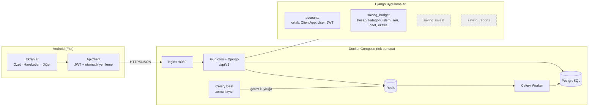
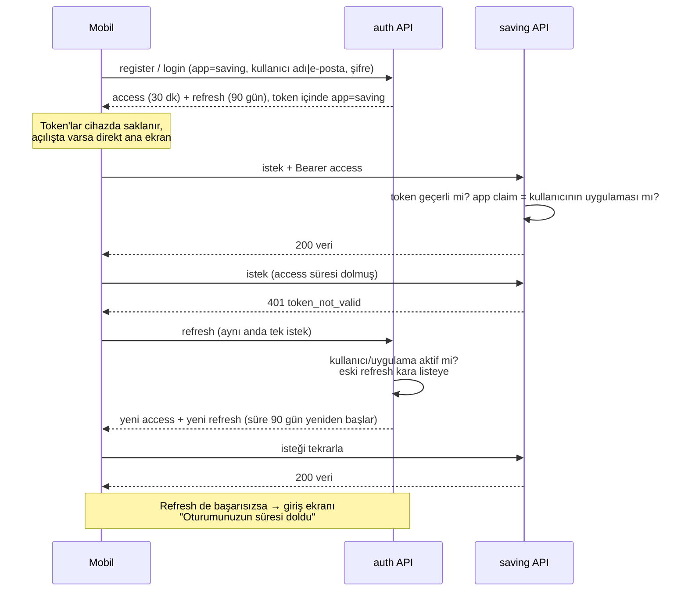
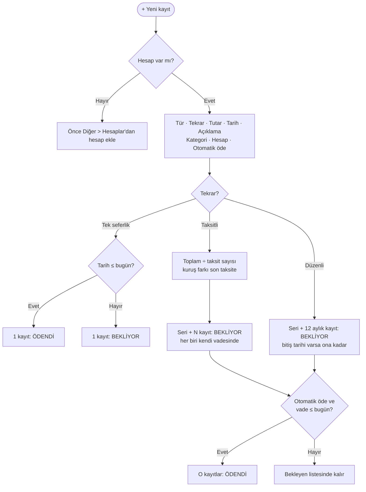
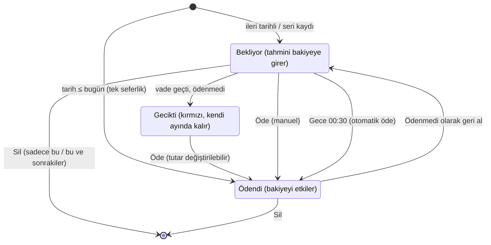
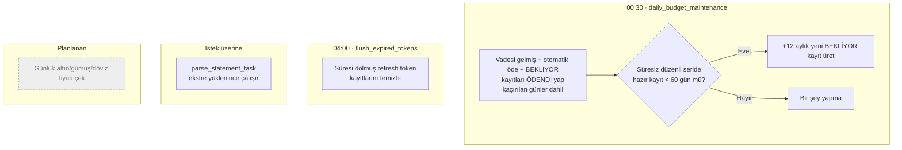
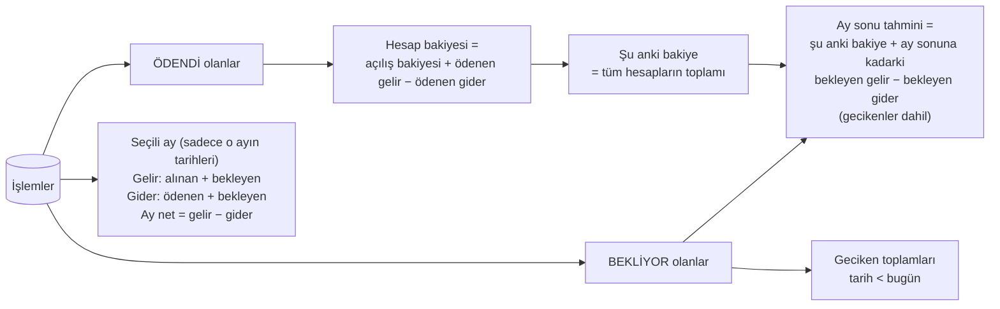
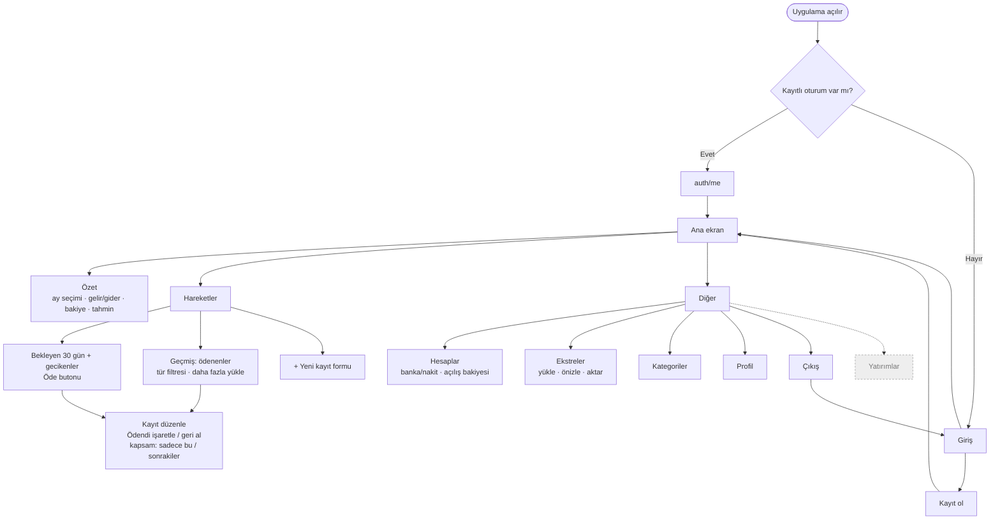
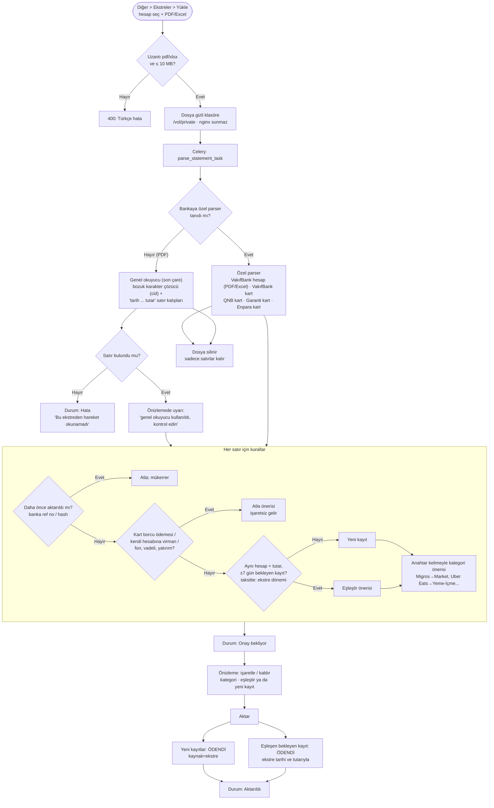
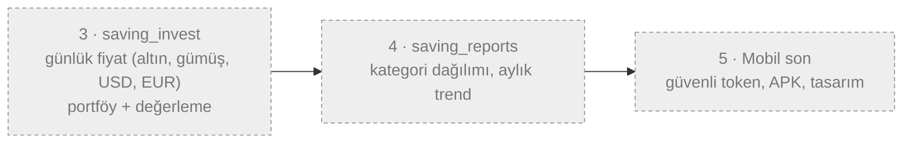

# Akış Şeması

Sistemin uçtan uca akışı. Her faz tamamlandığında bu dosya güncellenir.
Kesikli çizgili / gri kutular henüz yapılmamış (planlanan) kısımlardır.

**Son güncelleme:** Faz 2b (ekstre aktarma) — 2026-11-09

---

## 1. Genel mimari

---

## 2. Kimlik doğrulama ve oturum

---

## 3. Yeni kayıt oluşturma (tek form)

---

## 4. Bir kaydın yaşam döngüsü

**Seri kaydını düzenleme/silme kapsamı**
- *Sadece bu kayıt:* yalnızca o tarihteki kayıt değişir.
- *Bu ve sonraki bekleyenler:* tutar/açıklama/kategori/hesap/otomatik öde sonraki bekleyen kayıtlara ve serinin şablonuna uygulanır (ör. kira zammı). Silmede seri durur, ödenmiş geçmiş korunur.

---

## 5. Gece görevleri (Celery Beat)

---

## 6. Bakiye ve Özet hesabı

---

## 7. Mobil ekran akışı

---

## 8. Ekstre aktarma

**Kart ekstresi kuralları**
- Önceki dönem bakiyesi, toplam ve "ödemeniz için teşekkürler" satırları hiç gelmez; harcamalar tek tek gelir.
- Hesap ekstresindeki "Kredi Kartı Borç Ödeme" satırı atlanır (çift sayım olmasın).
- Önceki dönemde başlamış taksit (ekstrede eski alışveriş tarihiyle görünür) → ekstre kesim tarihine yazılır.
- İade (eksi tutar) → gelir.

---

## 9. Planlanan fazlar (henüz yok)

