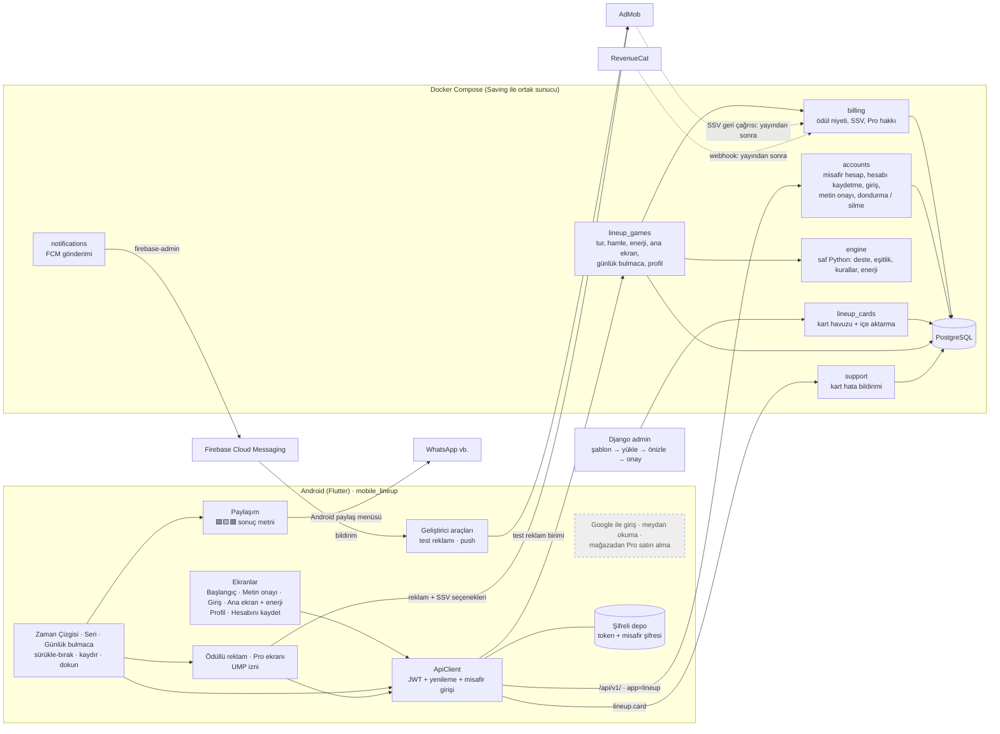
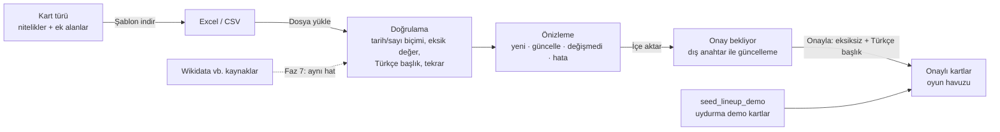
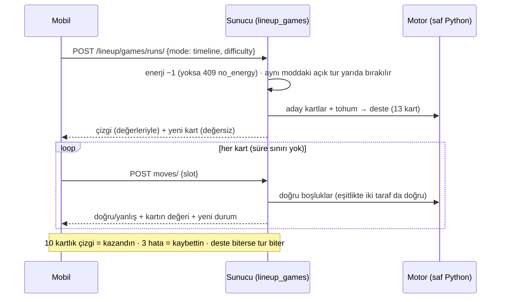
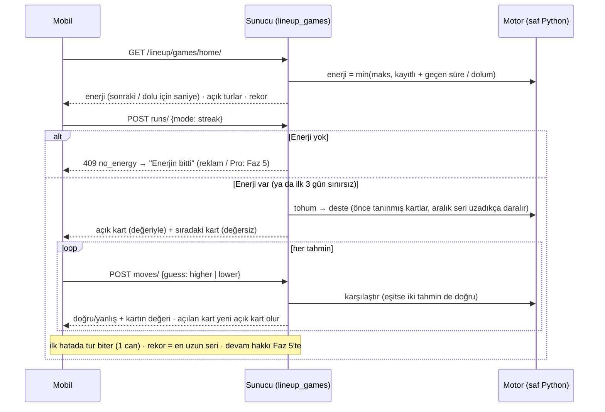
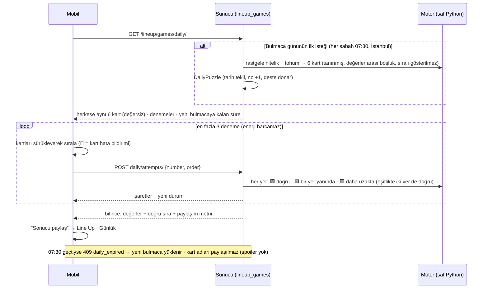
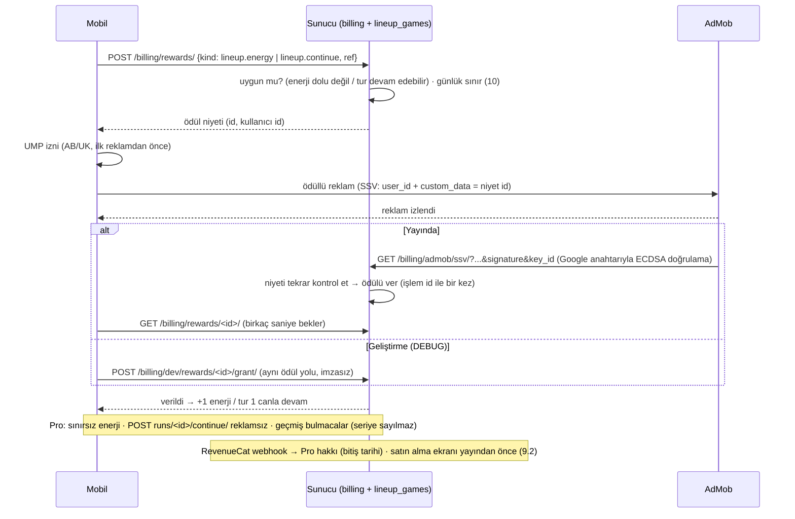

# Akış Şeması: Line Up

Line Up istemcisinin uçtan uca akışı. Her faz tamamlandığında bu dosya güncellenir.
Kesikli çizgili / gri kutular henüz yapılmamış (planlanan) kısımlardır.

**Son güncelleme:** Faz 5 (ödüllü reklam, Pro, bulmaca arşivi; mağaza bağlantısı yayından önce) — 2026-11-22

---

## 1. Genel mimari



## 2. İlk açılış ve oturum

```mermaid
sequenceDiagram
    participant M as Mobil
    participant S as Sunucu (accounts)
    M->>M: Şifreli depoda oturum var mı?
    alt Oturum var
        M->>S: GET /auth/me/
        S-->>M: kullanıcı + onaylanmamış metinler + hesap durumu
        Note over M: Yeni metin sürümü varsa → onay ekranı → POST /auth/consents/
        Note over M: Dondurulmuş / silinmeyi bekliyor → "Yeniden aç" (POST /auth/account/reactivate/) ya da çıkış
    else Kayıtlı hesap vardı ama oturum yok (çıkış, dondurma, süre doldu)
        M->>M: Giriş ekranı (e-posta dolu) · ya da "Misafir olarak yeni başla"
    else İlk açılış
        M->>S: GET /legal/lineup/
        S-->>M: gizlilik + KVKK (güncel sürümler)
        M->>M: Onay ekranı (oku, işaretle, devam) · "Zaten hesabın var mı? Giriş yap"
        M->>S: POST /auth/guest/ {app, accepted_documents}
        S-->>M: kullanıcı + misafir şifresi (bir kez) + JWT
        M->>M: Şifre ve token'ları şifreli depoya yaz
    end
    Note over M,S: 401 → refresh token ile yenile; misafirse misafir şifresiyle yeniden giriş, kayıtlıysa giriş ekranı
    M->>M: Ana ekran
```

## 2b. Hesabı kaydetme ve başka cihazda giriş

```mermaid
sequenceDiagram
    participant M as Mobil
    participant S as Sunucu (accounts)
    M->>S: POST /auth/guest/claim/ {email, password, username?}
    S->>S: aynı kullanıcı satırı: e-posta + şifre, misafir değil · eski oturumlar kapanır
    S-->>M: kullanıcı + yeni JWT
    M->>M: misafir şifresini sil, giriş adını sakla
    Note over M,S: Yeni cihaz: onay ekranı → "Giriş yap" → POST /auth/login/ {app, identifier, password} → ilerleme geri gelir
    M->>S: Profil: çıkış (POST /auth/logout/) · dondur / sil (şifreyle; misafir saklı şifresiyle)
    Note over M,S: Google ile giriş: ertelendi (Faz 4.1b)
```

## 3. Kart havuzu ve içe aktarma



## 4. Zaman Çizgisi turu



## 5. Seri turu ve enerji



## 6. Günlük bulmaca ve paylaşım



## 7. Ödüllü reklam ve Pro


