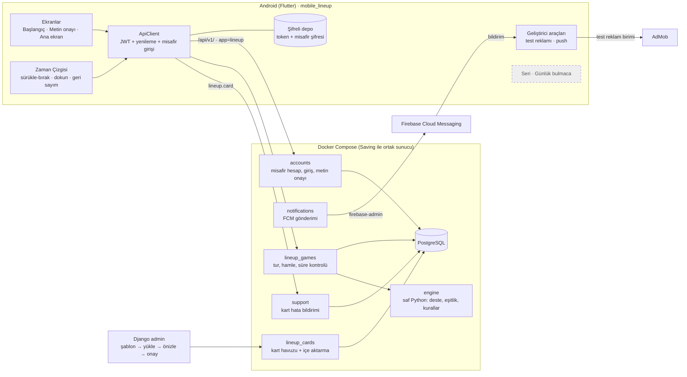
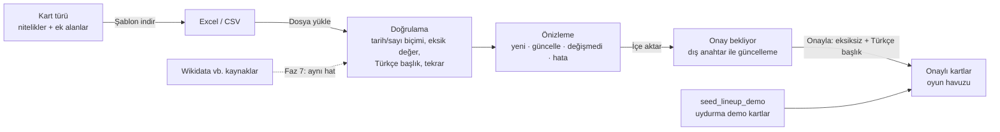
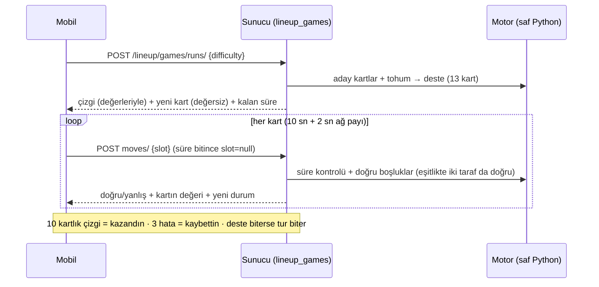

# Akış Şeması: Line Up

Line Up istemcisinin uçtan uca akışı. Her faz tamamlandığında bu dosya güncellenir.
Kesikli çizgili / gri kutular henüz yapılmamış (planlanan) kısımlardır.

**Son güncelleme:** Faz 1 (kart havuzu, içe aktarma, oyun motoru, Zaman Çizgisi) — 2026-11-22

---

## 1. Genel mimari



## 2. İlk açılış ve oturum

```mermaid
sequenceDiagram
    participant M as Mobil
    participant S as Sunucu (accounts)
    M->>M: Şifreli depoda oturum var mı?
    alt Oturum var
        M->>S: GET /auth/me/
        S-->>M: kullanıcı + onaylanmamış metinler
        Note over M: Yeni metin sürümü varsa → onay ekranı → POST /auth/consents/
    else İlk açılış
        M->>S: GET /legal/lineup/
        S-->>M: gizlilik + KVKK (güncel sürümler)
        M->>M: Onay ekranı (oku, işaretle, devam)
        M->>S: POST /auth/guest/ {app, accepted_documents}
        S-->>M: kullanıcı + misafir şifresi (bir kez) + JWT
        M->>M: Şifre ve token'ları şifreli depoya yaz
    end
    Note over M,S: 401 → refresh token ile yenile; o da geçersizse misafir şifresiyle yeniden giriş
    M->>M: Ana ekran
```

## 3. Kart havuzu ve içe aktarma



## 4. Zaman Çizgisi turu


