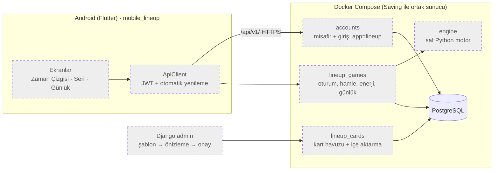

# Akış Şeması: Line Up

Line Up istemcisinin uçtan uca akışı. Her faz tamamlandığında bu dosya güncellenir.
Kesikli çizgili kutular henüz yapılmamış (planlanan) kısımlardır.

**Son güncelleme:** Faz 0 planlandı (henüz kod yok) — 2026-11-21

---

## 1. Genel mimari (planlanan)

