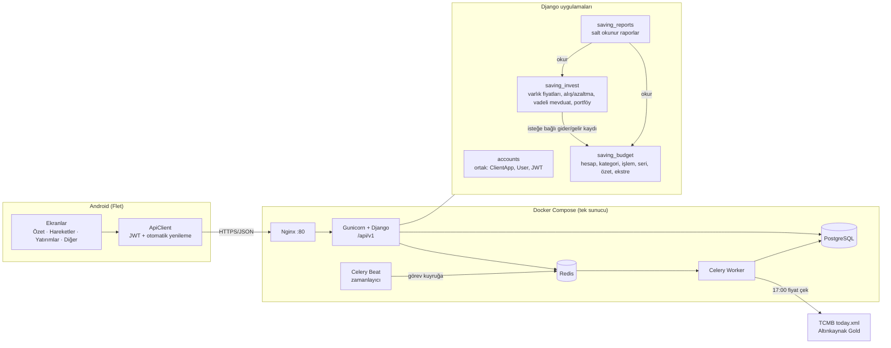
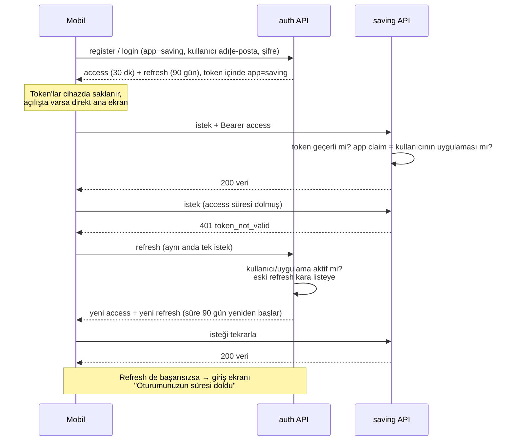
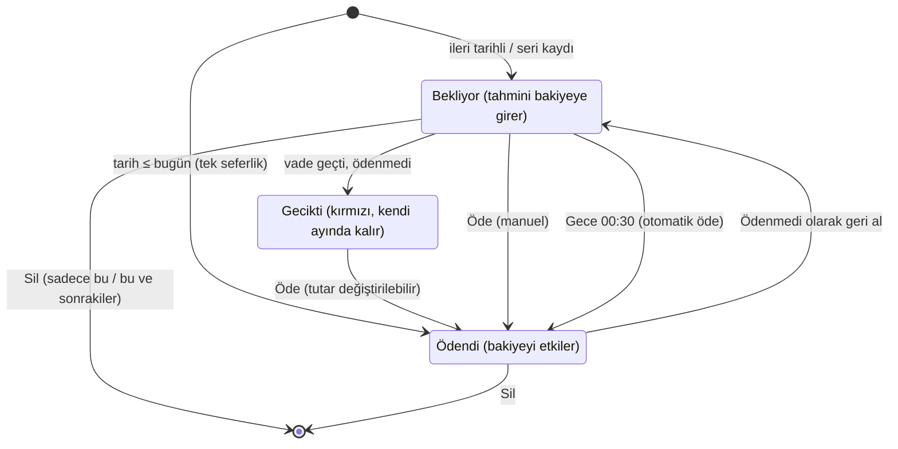
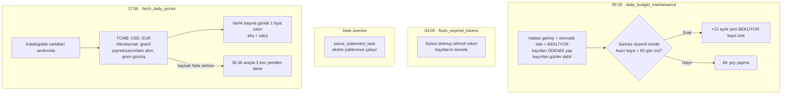
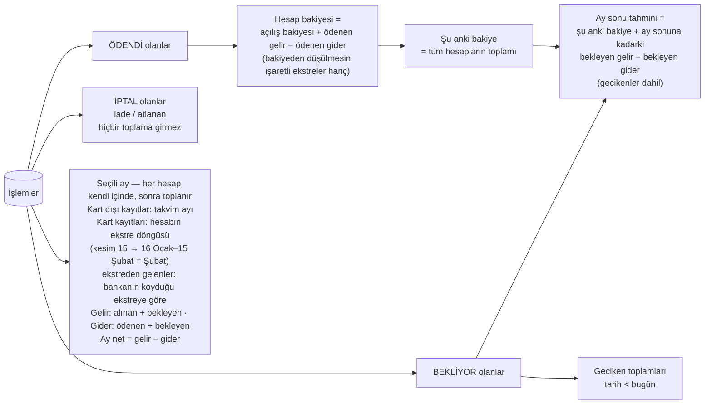
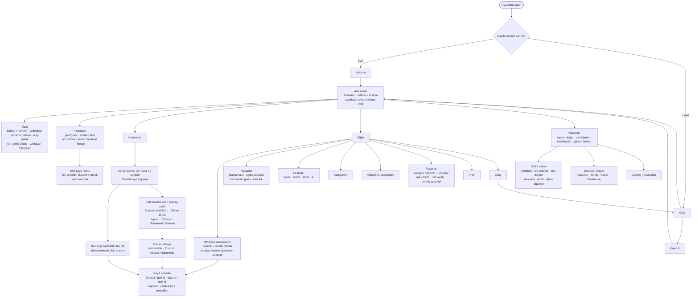
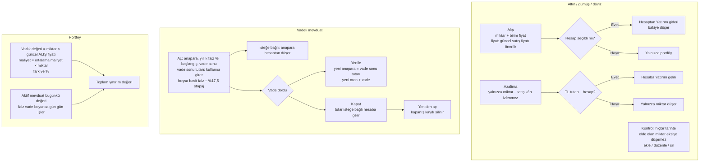
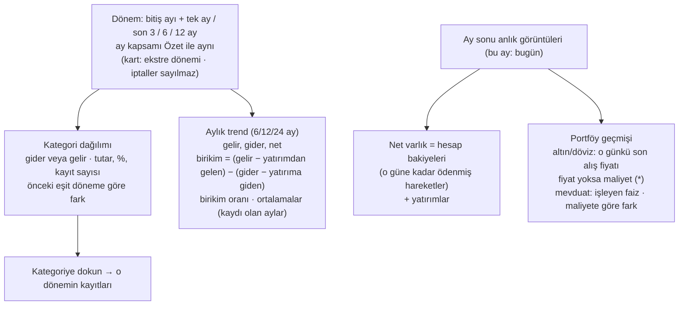
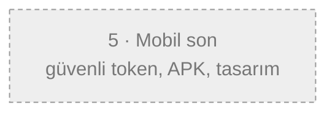

# Akış Şeması

Sistemin uçtan uca akışı. Her faz tamamlandığında bu dosya güncellenir.
Kesikli çizgili / gri kutular henüz yapılmamış (planlanan) kısımlardır.

**Son güncelleme:** Ekstre okuyucu doğruluk çalışması (özet okuyucu, ek kontroller, olası yorumların denenmesi, satır notları, okuma kalitesi, örnek seti) — 2026-11-28

---

## 1. Genel mimari



---

## 2. Kimlik doğrulama ve oturum



---

## 3. Yeni kayıt oluşturma (tek form)

```mermaid
flowchart TD
    START([+ Yeni kayıt]) --> HESAP{Hesap var mı?}
    HESAP -- Hayır --> UYARI[Önce Diğer > Hesaplar'dan hesap ekle]
    HESAP -- Evet --> FORM[Tür · Tekrar · Tutar · Tarih · Açıklama<br/>Kategori · Hesap · Otomatik öde]
    FORM --> TEKRAR{Tekrar?}

    TEKRAR -- Tek seferlik --> TARIH{Tarih ≤ bugün?}
    TARIH -- Evet --> PAID1[1 kayıt: ÖDENDİ]
    TARIH -- Hayır --> PEND1[1 kayıt: BEKLİYOR]

    TEKRAR -- Taksitli --> SPLIT[Toplam ÷ taksit sayısı<br/>kuruş farkı son taksite]
    SPLIT --> SERI1[Seri + N kayıt: BEKLİYOR<br/>her biri kendi vadesinde]

    TEKRAR -- Düzenli --> SERI2[Seri + 12 aylık kayıt: BEKLİYOR<br/>bitiş tarihi varsa ona kadar]

    SERI1 --> AUTO{Otomatik öde ve<br/>vade ≤ bugün?}
    SERI2 --> AUTO
    AUTO -- Evet --> PAID2[O kayıtlar: ÖDENDİ]
    AUTO -- Hayır --> BEKLE[Bekleyen listesinde kalır]
```



---

## 4. Bir kaydın yaşam döngüsü



**Seri kaydını düzenleme/silme kapsamı**
- *Sadece bu kayıt:* yalnızca o tarihteki kayıt değişir.
- *Bu ve sonraki bekleyenler:* tutar/açıklama/kategori/hesap/otomatik öde sonraki bekleyen kayıtlara ve serinin şablonuna uygulanır (ör. kira zammı). Silmede seri durur, ödenmiş geçmiş korunur.

---

## 5. Gece görevleri (Celery Beat)



---

## 6. Bakiye ve Özet hesabı



---

## 7. Mobil ekran akışı



---

## 8. Ekstre aktarma

```mermaid
flowchart TD
    UP([Diğer > Ekstreler > Yükle<br/>hesap seç + PDF/Excel<br/>☐ bakiyeden düşülmesin]) --> V{Uzantı pdf/xlsx<br/>ve ≤ 10 MB?}
    V -- Hayır --> E400[400: Türkçe hata]
    V -- Evet --> SAVE[Dosya gizli klasöre<br/>/vol/private · nginx sunmaz]
    SAVE --> TASK[Celery: parse_statement_task]
    TASK --> ENG["Tek genel okuyucu (tüm bankalar)<br/>kelimeler + sayfadaki konumları → tarihle başlayan satırlar<br/>tutar sütunları hizalamadan bulunur, başlıktan adlandırılır<br/>(Tutar · Borç/Alacak · Bakiye · Taksit · Puan)<br/>sayı biçimi her sayıda ayrı: 1.234,56 / 1,234.56<br/>Excel: başlık satırı aynı kelimelerle bulunur"]
    ENG --> META[Banka + tür metinden tanınır<br/>kart: hesap kesim, dönem · hesap: tarih aralığı, bakiye]
    META --> SUM["Kart özeti okunur (banka kodu yok)<br/>'etiket : tutar' · ızgara / denklem (etiketler üstte, tutarlar altta)<br/>· tablodaki özet satırı<br/>kendi içinde tutan okumalar: önceki + harcama − ödeme = borç"]
    SUM --> DET["Tarihsiz satırlar üstteki işleme bağlanır<br/>metin: açıklama / 'N / M taksidi' · tutarlar: döküm<br/>(Anapara+Faiz+BSMV = işlem) ya da tarihi düşmüş satır adayı"]
    DET --> HYP["Olası yorumların hepsi denenir:<br/>alışveriş işareti × tarihsiz tutarlar × özet okumaları<br/>ekstrenin en iyi doğruladığı seçilir (eşitlikte en olası)"]
    HYP --> OK{Satır bulundu mu?}
    OK -- Hayır --> FAIL[Durum: Hata<br/>'Bu ekstreden hareket okunamadı' + Sorun bildir]
    OK -- Evet --> CHK{"Öz-denetim (her kontrol ayrı)<br/>kart: önceki + satırlar = dönem borcu,<br/>harcamalar, ödemeler (özette basılıysa)<br/>hesap: satır satır bakiye + kapanış bakiyesi"}
    CHK -- Tutuyor --> GOOD[Önizlemede ✓ doğrulandı<br/>dönem borcu, harcamalar, ödemeler]
    CHK -- Tutmuyor --> WARN["Önizlemede ⚠ fark X TL + kontrol listesi<br/>farkı açıklayan satırlar işaretli<br/>(aynı tutar / iki katı = yön ters / tarihsiz tutar)<br/>PDF ise Excel önerisi + 'bu ekstreyi bize bildirin'"]
    CHK -- Toplam yok --> UNK[Önizlemede 'kontrol edin' + Excel önerisi]
    GOOD --> RULES
    WARN --> RULES
    UNK --> RULES
    ENG --> DEL[Dosya silinir<br/>sadece satırlar kalır]
    CHK --> LOG[("Okuma kaydı (anonim)<br/>banka · tür · dosya türü · motor sürümü<br/>kontroller · işaretli satır sayısı")]

    subgraph RULES["Her satır için kurallar"]
        K1{Daha önce aktarıldı mı?<br/>banka ref no / hash /<br/>aynı tarih+tutar+tür} -- Evet --> SK1[Atla: mükerrer]
        K1 -- Hayır --> K2{Kart borcu ödemesi<br/>(hesapta ya da kart ekstresinde) /<br/>kendi hesabına virman /<br/>fon, vadeli, yatırım?}
        K2 -- Evet --> SK2[Atla önerisi<br/>işaretsiz gelir]
        K2 -- Hayır --> K3{Aynı hesap + tutar,<br/>±7 gün bekleyen kayıt?<br/>taksitte: ekstre dönemi}
        K3 -- Evet --> MT[Eşleştir önerisi]
        K3 -- Hayır --> IM[Yeni kayıt]
        IM --> CAT["Kategori önerisi (asla boş kalmaz)<br/>1 bilinen işyeri: Migros→Market, Uber Eats→Yeme-İçme<br/>2 amaç: kira bedeli/aidat→Kira, maaş→Maaş<br/>3 kanal: ATM→Nakit Çekim, FAST/EFT→Para Transferi,<br/>masraf/ücret→Banka Masrafı<br/>4 online: .com, iyzico, paytr→Online Alışveriş<br/>5 kart iadesi→İade<br/>6 yedek: Diğer Gider / Diğer Gelir"]
        MT --> CAT
    end

    RULES --> READY[Durum: Onay bekliyor]
    READY --> REVIEW["Önizleme: işaretle / kaldır<br/>satır notları: ⚠ kontrol edin · bilgi (taksit asıl tarihi)<br/>'yalnızca kontrol gereken satırlar' filtresi<br/>kategori değişince öğrenilir ve<br/>aynı işyerinin satırlarına uygulanır<br/>eşleştir / iade / yeni kayıt"]
    REVIEW --> CONF["Aktar<br/>☑ aktardıktan sonra ekstre bilgilerini sil"]
    CONF --> LOG2[("Okuma kaydına: önerilenden farklı<br/>dahil edilen/çıkarılan satır ve<br/>değiştirilen kategori sayısı")]
    CONF --> T1[Yeni kayıtlar: ÖDENDİ<br/>kaynak=ekstre · kartsa ekstre kesim tarihi]
    CONF --> T2[Eşleşen bekleyen kayıt: ÖDENDİ<br/>ekstre tarihi ve tutarıyla]
    CONF --> T3[İade: ilgili harcama İPTAL]
    T1 --> DONE[Durum: Aktarıldı<br/>ham ekstre metni temizlenir]
    T2 --> DONE
    T3 --> DONE
    DONE --> DEL{Silme seçili mi?}
    DEL -- Evet --> GONE[Ekstre kaydı + satırlar silinir<br/>harcamalar kalır]
    DEL -- Hayır --> KEEP[Ekstreler listesinde kalır<br/>istenirse sonradan silinir]
```

**Gizlilik**
- Ekstre dosyası okunduktan hemen sonra silinir; okunamamış dosyalar gece görevinde (1 saatten eski) silinir.
- Kart numarası ve kişisel bilgiler ekstreden okunmaz/saklanmaz. Kart adı sadece banka adından oluşur.
- Aynı ekstre tekrar yüklenirse (ekstre kaydı silinmiş olsa bile) aktarılan harcamaların anahtarlarıyla mükerrer yakalanır.

**Kart ekstresi kuralları**
- Önceki dönem bakiyesi, toplam ve "ödemeniz için teşekkürler" satırları hiç gelmez; harcamalar tek tek gelir.
- Hesap ekstresindeki "Kredi Kartı Borç Ödeme" satırı atlanır (çift sayım olmasın).
- Önceki dönemde başlamış taksit (ekstrede eski alışveriş tarihiyle görünür) → ekstre kesim tarihine yazılır
  (bilgi notu: asıl işlem tarihi). Taksit bilgisi alttaki satırdan da okunur ("… işlemin 20 / 40 taksidi").
- Taksit bilgisi olmayan ama dönemden 45 günden eski tarihli satır → kesim tarihine yazılır, ⚠ "tarihi kontrol edin".
- Kesim tarihinden sonraki tarih → ⚠ "dönemin dışında".
- İade (eksi tutar) → gelir.

**Okuyucuyu geliştirme (geliştirici)**
- Örnek seti: `backend/statement_samples/` (git'e ve Docker imajına girmez). Gerçek ekstre
  `make_statement_sample <dosya>` ile maskelenir (isim, adres, kart/IBAN/müşteri no, e-posta; konum, tutar ve
  tarih korunur) ve orijinal gibi okunduğu doğrulanır; asıl dosya sonra silinebilir.
- Her motor değişikliğinden sonra `check_statements`: tüm örnekleri okur, beklenen sonuçla farkları gösterir;
  farklar kontrol edilince `--accept`.
- Admin › Ekstre okuma kayıtları › **Okuma kalitesi**: banka / tür / dosya türü / motor sürümü bazında doğrulanma
  oranı, tutmayan ve okunamayan okumalar, işaretli satır oranı, kullanıcının değiştirdiği satır ve kategori oranı.

---

## 9. Yatırımlar (saving_invest)



---

## 10. Raporlar (saving_reports)



---

## 11. Planlanan fazlar (henüz yok)


